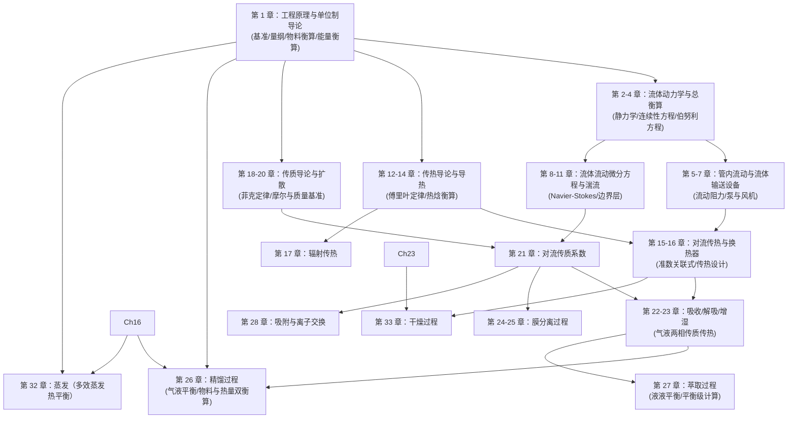

# 《化工原理》（Transport Processes and Separation Process Principles）第5版 章节全书索引与依赖全景

- **原著书名**：*Transport Processes and Separation Process Principles* (Fifth Edition)
- **作者**：Christie John Geankoplis, A. Allen Hersel, Daniel H. Lepek
- **出版社 / 年份**：Prentice Hall / Pearson, 2018
- **ISBN-13**：978-0-13-418102-8
- **总页数**：1836 页（PDF 页码与印刷页码严格对齐，1-based 页序等于纸质页码）
- **教材体系**：全书分为两大部分：Part 1 传递过程（动量传递、热量传递、质量传递，第 1–21 章）与 Part 2 分离过程原理（单元操作，第 22–33 章），后附附录 A.1–A.6、符号表（Notation）与索引（Index）。

---

## 一、 全书 33 章章节边界与原书页码核验表

| 序号 | 英文章节名 | 中文标准译名 | 印刷页码 / PDF 页序 | 对应知识领域 | 前置依赖章节 |
| :--- | :--- | :--- | :--- | :--- | :--- |
| **Ch 01** | **Introduction to Engineering Principles and Units** | **工程原理与单位制导论** | **pp. 37–83** | **工程基础（单位/衡算）** | **无（全书基石）** |
| Ch 02 | Introduction to Fluids and Fluid Statics | 流体与流体静力学导论 | pp. 84–103 | 流体动力学基础 | Ch 01 |
| Ch 03 | Fluid Properties and Fluid Flows | 流体性质与流动现象 | pp. 104–119 | 流体动力学基础 | Ch 01, Ch 02 |
| Ch 04 | Overall Mass, Energy, and Momentum Balances | 总质量、能量与动量衡算 | pp. 120–183 | 流体动力学核心衡算 | Ch 01, Ch 02, Ch 03 |
| Ch 05 | Incompressible and Compressible Flows in Pipes | 管内不可压缩与可压缩流动 | pp. 184–239 | 管流与阻力计算 | Ch 04 |
| Ch 06 | Flows in Packed and Fluidized Beds | 填料床与流化床流动 | pp. 240–269 | 颗粒床层流体动力学 | Ch 03, Ch 05 |
| Ch 07 | Pumps, Compressors, and Agitation Equipment | 泵、压缩机与搅拌设备 | pp. 270–313 | 流体输送与机械设备 | Ch 04, Ch 05 |
| Ch 08 | Differential Equations of Fluid Flow | 流体流动微分方程（Navier-Stokes） | pp. 314–347 | 高级流体力学推导 | Ch 03, Ch 04 |
| Ch 09 | Non-Newtonian Fluids | 非牛顿流体 | pp. 348–375 | 复杂流体流变学 | Ch 03, Ch 08 |
| Ch 10 | Potential Flow and Creeping Flow | 势流与蠕动流 | pp. 376–390 | 边界流体解析 | Ch 08 |
| Ch 11 | Boundary-Layer and Turbulent Flow | 边界层与湍流流动 | pp. 391–412 | 湍流与流动分离 | Ch 05, Ch 08 |
| Ch 12 | Introduction to Heat Transfer | 热量传递导论（导热/对流/辐射） | pp. 413–461 | 传热学基础 | Ch 01, Ch 04 |
| Ch 13 | Steady-State Conduction | 稳态热传导 | pp. 462–508 | 导热计算 | Ch 12 |
| Ch 14 | Principles of Unsteady-State Heat Transfer | 不稳态热传导原理 | pp. 509–579 | 不稳态传热方程与图表 | Ch 13 |
| Ch 15 | Introduction to Convection | 对流传热导论 | pp. 580–666 | 对流给热系数关联式 | Ch 05, Ch 12 |
| Ch 16 | Heat Exchangers | 换热器 | pp. 667–691 | 换热设备工艺设计 | Ch 12, Ch 13, Ch 15 |
| Ch 17 | Introduction to Radiation Heat Transfer | 辐射传热导论 | pp. 692–730 | 辐射换热计算 | Ch 01, Ch 12 |
| Ch 18 | Introduction to Mass Transfer | 质量传递导论（扩散原理） | pp. 731–779 | 传质学基础 | Ch 01 |
| Ch 19 | Steady-State Mass Transfer | 稳态分子传质 | pp. 780–851 | 稳态扩散方程与积分 | Ch 18 |
| Ch 20 | Unsteady-State Mass Transfer | 不稳态质量传递 | pp. 852–876 | 不稳态扩散模型 | Ch 19 |
| Ch 21 | Convective Mass Transfer | 对流质量传递 | pp. 877–935 | 传质系数与双膜理论 | Ch 15, Ch 18, Ch 19 |
| Ch 22 | Absorption and Stripping | 气体吸收与解吸 | pp. 936–1035 | 气液传质分离过程 | Ch 19, Ch 21 |
| Ch 23 | Humidification Processes | 增湿与减湿过程 | pp. 1036–1067 | 气液传热传质过程 | Ch 15, Ch 21 |
| Ch 24 | Filtration and Membrane Separation Processes | 过滤与膜分离过程（液-液/固-液） | pp. 1068–1130 | 机械分离与微滤/超滤/反渗透 | Ch 06, Ch 21 |
| Ch 25 | Gaseous Membrane Systems | 气体膜分离系统 | pp. 1131–1195 | 气体分离与渗透 | Ch 18, Ch 21 |
| Ch 26 | Distillation | 蒸馏与精馏 | pp. 1196–1296 | 平衡级分离核心（McCabe-Thiele） | Ch 01, Ch 16, Ch 22 |
| Ch 27 | Liquid–Liquid Extraction | 液-液萃取 | pp. 1297–1344 | 三元相平衡与级联萃取 | Ch 22, Ch 26 |
| Ch 28 | Adsorption and Ion Exchange | 吸附与离子交换 | pp. 1345–1374 | 固相吸附平衡与穿透曲线 | Ch 19, Ch 21 |
| Ch 29 | Crystallization and Particle Size Reduction | 结晶与颗粒微细化 | pp. 1375–1409 | 溶解度、过饱和与相变粒径 | Ch 01, Ch 28 |
| Ch 30 | Settling, Sedimentation, and Centrifugation | 沉降、沉淀与离心分离 | pp. 1410–1455 | 重力与离心力场机械分离 | Ch 03, Ch 06 |
| Ch 31 | Leaching | 浸取（固-液萃取） | pp. 1456–1482 | 多级逆流浸取计算 | Ch 27 |
| Ch 32 | Evaporation | 蒸发过程 | pp. 1483–1531 | 单效与多效蒸发、热量衡算 | Ch 01, Ch 16 |
| Ch 33 | Drying | 干燥过程 | pp. 1532–1635 | 干燥动力学、对流传热传质 | Ch 15, Ch 21, Ch 23 |

---

## 二、 跨章核心依赖网络与结构关系

---

## 三、 第 1 章在全书中的基石定位与学案研发重点

第 1 章是化工过程所有定量分析的共同语言和公理化起点：
1. **量纲与单位一致性**：SI、CGS 与英制 FPS 单位制，量纲齐次性方程（Dimensional Homogeneity），重力加速度换算因子 $g_c$。
2. **状态与组成表示**：温度标度换算（K, °C, °R, °F），摩尔基准与质量基准的互换，溶液质量分数、摩尔分数、物质的量浓度与体积浓度。
3. **气体状态方程与蒸气压**：理想气体状态方程（$PV=nRT$），道尔顿分压定律与阿马加分体积定律，安托万方程（Antoine Equation）与液体饱和蒸气压、沸点。
4. **质量守恒与物料衡算**：稳态与非稳态系统边界，单单元与多单元流程，旁路（Bypass）、循环（Recycle）与排放（Purge），化学反应系统中的限制反应物、转化率与多组分物料衡算。
5. **能量守恒与热量衡算**：热容（定压比热容 $C_p$ 随温度多项式拟合）与显热积分，相变潜热与蒸汽表（Steam Tables）检索与线性内插，标准反应热与赫斯定律，非反应/反应系统的总焓衡算方程。
6. **数值积分**：梯形法则与辛普森法则（Simpson's Rule）在非解析物性热容积分与工程参数计算中的应用。
